# Architecture

Diagrams for the Agent Identity vs Application Identity POC. See the [README](../README.md) for the
narrative, the Entra setup steps and the run instructions. All diagrams are Mermaid and render on
GitHub, in VS Code (Markdown preview with Mermaid support) and in most wikis.

Contents

1. [Solution components](#1-solution-components)
2. [Entra objects and their relationships](#2-entra-objects-and-their-relationships)
3. [Permission model: who holds what](#3-permission-model-who-holds-what)
4. [Application runtime flows (direct API calls)](#4-application-runtime-flows-direct-api-calls)
5. [Agent runtime loop (LLM + MCP)](#5-agent-runtime-loop-llm--mcp)
6. [Browser sign-in and token minting](#6-browser-sign-in-and-token-minting)
7. [Choosing the identity: decision flow](#7-choosing-the-identity-decision-flow)
8. [Code structure of the host application](#8-code-structure-of-the-host-application)

---

## 1. Solution components

Five local processes plus Microsoft Entra. Two processes hold credentials (the host application
for its two identities, the MCP server for its own); two places make authorization decisions (the
MCP server on `Mcp.*`, the Claims API on `Claims.*`).

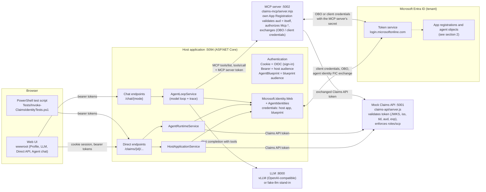

---

## 2. Entra objects and their relationships

The five Entra objects (three App Registrations, the blueprint and the agent identity), what each
one owns, and how grants attach to them. Note the two object kinds that often get confused: the
blueprint **application** (app id = object id) and the blueprint **principal** (a service principal
with its own object id).

```mermaid
erDiagram
    TENANT ||--o{ APP_REGISTRATION : contains
    TENANT ||--o{ SERVICE_PRINCIPAL : contains
    TENANT ||--o{ AGENT_BLUEPRINT : contains
    TENANT ||--o{ USER : contains

    APP_REGISTRATION ||--|| SERVICE_PRINCIPAL : "is represented by"
    APP_REGISTRATION ||--o{ DELEGATED_SCOPE : "exposes (Expose an API)"
    APP_REGISTRATION ||--o{ APP_ROLE : "defines (App roles, member type Applications)"

    AGENT_BLUEPRINT ||--|| BLUEPRINT_PRINCIPAL : "is represented by"
    AGENT_BLUEPRINT ||--o{ AGENT_IDENTITY : "creates and mints tokens for"
    AGENT_BLUEPRINT ||--o{ CREDENTIAL : "holds (secret, certificate, FIC)"
    AGENT_BLUEPRINT ||--o{ DELEGATED_SCOPE : "exposes access_agent"
    AGENT_BLUEPRINT ||--o{ INHERITABLE_PERMISSION : "declares"

    SERVICE_PRINCIPAL ||--o{ APP_ROLE_ASSIGNMENT : "is principal of"
    SERVICE_PRINCIPAL ||--o{ OAUTH2_PERMISSION_GRANT : "is client of"
    AGENT_IDENTITY ||--o{ APP_ROLE_ASSIGNMENT : "is principal of (direct)"
    AGENT_IDENTITY ||--o{ OAUTH2_PERMISSION_GRANT : "is client of (direct)"
    BLUEPRINT_PRINCIPAL ||--o{ APP_ROLE_ASSIGNMENT : "is principal of (inherited by agents)"
    BLUEPRINT_PRINCIPAL ||--o{ OAUTH2_PERMISSION_GRANT : "is client of (inherited by agents)"

    APP_ROLE ||--o{ APP_ROLE_ASSIGNMENT : "is granted through"
    DELEGATED_SCOPE ||--o{ OAUTH2_PERMISSION_GRANT : "is granted through"
    USER ||--o{ OAUTH2_PERMISSION_GRANT : "is subject of (delegated)"

    APP_REGISTRATION {
        guid appId "client id"
        guid objectId
        string displayName "POC Claims API, POC Claims Web, POC Claims MCP Server"
        string identifierUri "api://appId"
        int requestedAccessTokenVersion "2"
    }
    SERVICE_PRINCIPAL {
        guid objectId "oid in app-only tokens"
        guid appId
    }
    AGENT_BLUEPRINT {
        guid appId "{blueprintId} (= object id)"
        string displayName "POC Claims Analysis Agent Blueprint"
        string identifierUri "api://{blueprintId}"
    }
    BLUEPRINT_PRINCIPAL {
        guid objectId "e1dd3704..."
        guid appId "{blueprintId}"
    }
    AGENT_IDENTITY {
        guid appId "{agentId} (= object id)"
        guid parentAppId "blueprint app id, xms_par_app_azp"
        string displayName "POC Claims Analysis Agent"
        string credentials "none"
    }
    CREDENTIAL {
        string type "ClientSecret in this POC"
    }
    DELEGATED_SCOPE {
        string value "Claims.Archive, Claims.Analyze, Mcp.Archive, Mcp.Analyze, access_as_user, access_agent"
        string tokenClaim "scp"
    }
    APP_ROLE {
        string value "Claims.Archive.All, Claims.Analyze.All, Mcp.Archive.All, Mcp.Analyze.All"
        string allowedMemberTypes "Application"
        string tokenClaim "roles"
    }
    APP_ROLE_ASSIGNMENT {
        guid principalId
        guid resourceId "Claims API or MCP server service principal"
        guid appRoleId
    }
    OAUTH2_PERMISSION_GRANT {
        guid clientId
        guid resourceId
        string consentType "AllPrincipals"
        string scope
    }
    INHERITABLE_PERMISSION {
        guid resourceAppId
        string inheritableScopes "allAllowed or none"
        string inheritableRoles "allAllowed or none"
    }
    USER {
        guid objectId "oid in delegated tokens"
        string upn
    }
```

Three facts the diagram encodes:

- A normal App Registration and an agent blueprint both have a service principal, but only the
  blueprint can **mint tokens for other principals** (its agent identities).
- An agent identity has **no credential**; the blueprint's credential is used on its behalf.
- Grants to an agent identity are either **direct** (rows on the agent identity) or
  **inherited** (rows on the blueprint principal **plus** an inheritable-permission declaration
  for that resource). Inherited grants are only visible in the token.
- The MCP server registration is **both a resource and a client**: it defines the `Mcp.*` scopes
  and app roles that the host app and the agent identity are granted, and its own service
  principal holds the `Claims.*` grants it uses when it exchanges tokens for the Claims API.

---

## 3. Permission model: who holds what

```mermaid
flowchart TB
    subgraph ClaimsAPI["POC Claims API (resource) defines"]
        S1["scope Claims.Archive<br/>(delegated, scp)"]
        S2["scope Claims.Analyze<br/>(delegated, scp)"]
        R1["app role Claims.Archive.All<br/>(application, roles)"]
        R2["app role Claims.Analyze.All<br/>(application, roles)"]
    end

    subgraph Blueprint["Agent blueprint exposes"]
        S4["scope access_agent<br/>(audience for scenario 4)"]
    end

    subgraph HostApp["Host app exposes"]
        S3["scope access_as_user<br/>(audience for scenario 2)"]
    end

    subgraph McpSrv["MCP server (resource) defines"]
        M1["scope Mcp.Archive (scp)"]
        M2["scope Mcp.Analyze (scp)"]
        M3["app role Mcp.Archive.All (roles)"]
        M4["app role Mcp.Analyze.All (roles)"]
    end

    HOST["Host application<br/>POC Claims Web<br/>(service principal)"]
    AGENT["Agent identity<br/>POC Claims Analysis Agent"]
    MCPSP["MCP server<br/>POC Claims MCP Server<br/>(service principal)"]

    HOST -->|"scenario 1"| R1
    HOST -->|"scenario 2 (delegated)"| S1
    HOST -->|"token to self"| S3
    HOST -->|"needed to call scenario 4"| S4
    AGENT -->|"scenario 3"| R2
    AGENT -->|"scenario 4 (delegated)"| S2

    HOST -->|"agent loop: host-app"| M3
    HOST -->|"agent loop: host-user"| M1
    AGENT -->|"agent loop: agent-app"| M4
    AGENT -->|"agent loop: agent-user"| M2
    MCPSP -->|"exchange, app-only"| R1
    MCPSP -->|"exchange, app-only"| R2
    MCPSP -->|"exchange, OBO"| S1
    MCPSP -->|"exchange, OBO"| S2

    HOST -. "never granted: negative test N2" .-> R2
    AGENT -. "never granted: negative test N1" .-> R1
    HOST -. "never granted" .-> M4
    AGENT -. "never granted" .-> M3
```

---

## 4. Application runtime flows (direct API calls)

Deterministic application code decides what to call and which identity to use. The four
sequences below are scenarios 1 to 4 of [Scenarios at a glance](scenarios.md).

### 4.1 Scenario 1: host application, application permission (no user)

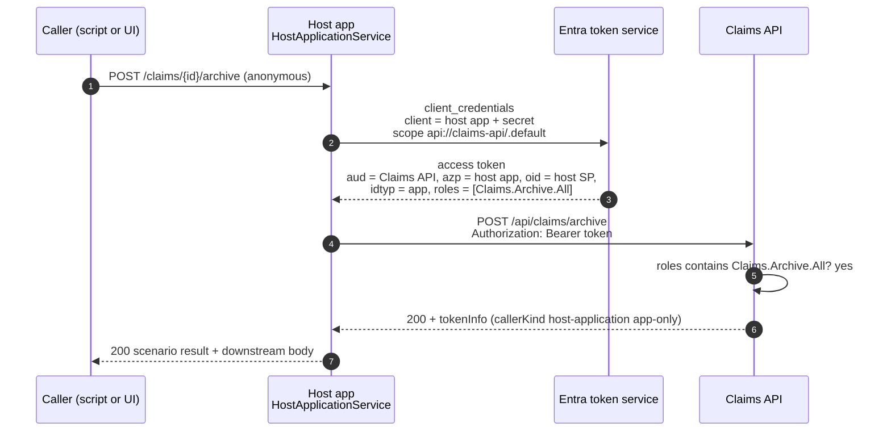

### 4.2 Scenario 2: host application on behalf of a signed-in user

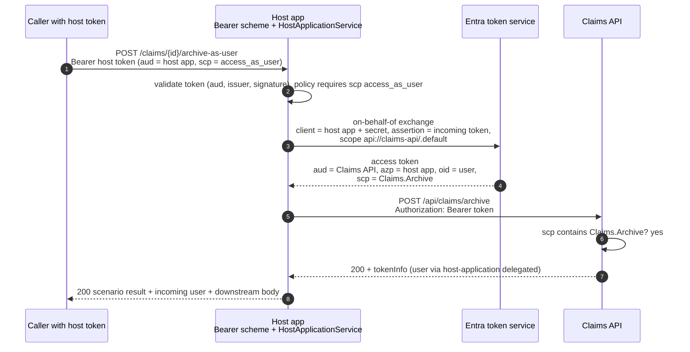

### 4.3 Scenario 3: agent identity, application permission (autonomous agent)

The blueprint's credential is used, but the token represents the agent identity.

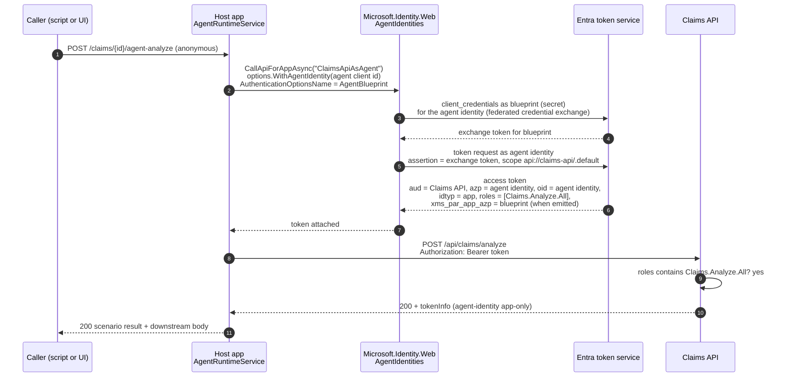

### 4.4 Scenario 4: agent identity on behalf of a signed-in user (interactive agent)

The incoming token's audience must be the **blueprint**, not the host app.

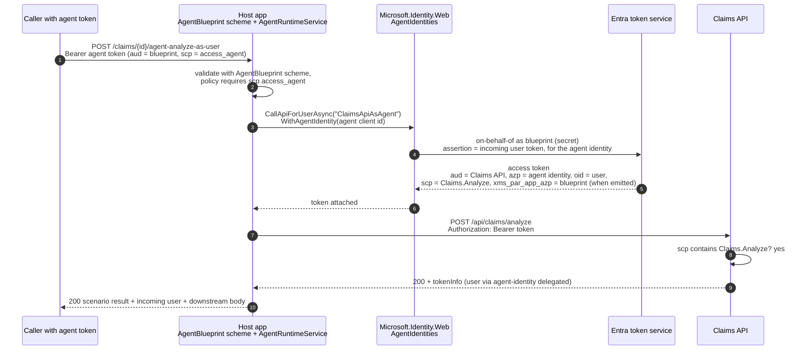

### 4.5 Negative cases

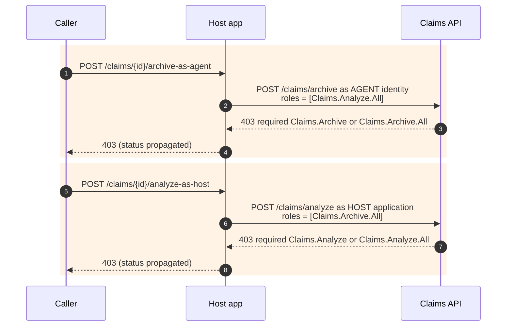

---

## 5. Agent runtime loop (LLM + MCP)

The model proposes tool calls; the host application decides the identity **once per chat turn**
(fixed by the route), mints exactly one token **for the MCP server**, and every MCP call in that
turn carries it. The MCP server validates that token, enforces its own `Mcp.*` permissions per
tool, and exchanges it for a Claims API token with its own credential (on-behalf-of when a user is
present, client credentials otherwise). The inbound token is never forwarded; the Claims API sees
the MCP server as actor and makes a second allow/deny decision on `Claims.*`.

### 5.1 One chat turn

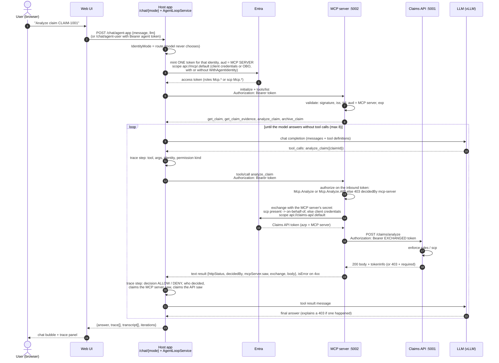

### 5.2 Where identity is decided versus where it is enforced

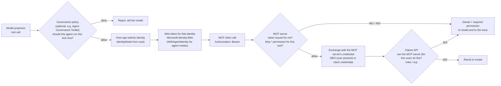

Three independent controls answer three questions: the policy layer decides whether the agent
**should** act; the MCP server decides whether the **calling identity** may use this tool; the
Claims API decides whether the **MCP server** (on behalf of the user, when present) may call it.

### 5.3 Identity modes available to the loop

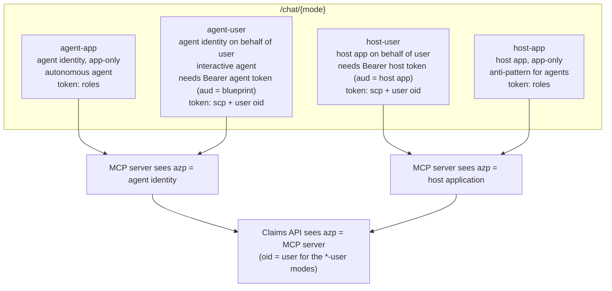

### 5.4 MCP server request pipeline

What `claims-mcp/server.mjs` does with every request. The inbound token is read, validated and
authorized here, and then set aside: the call to the Claims API uses a token the MCP server obtains
for itself.

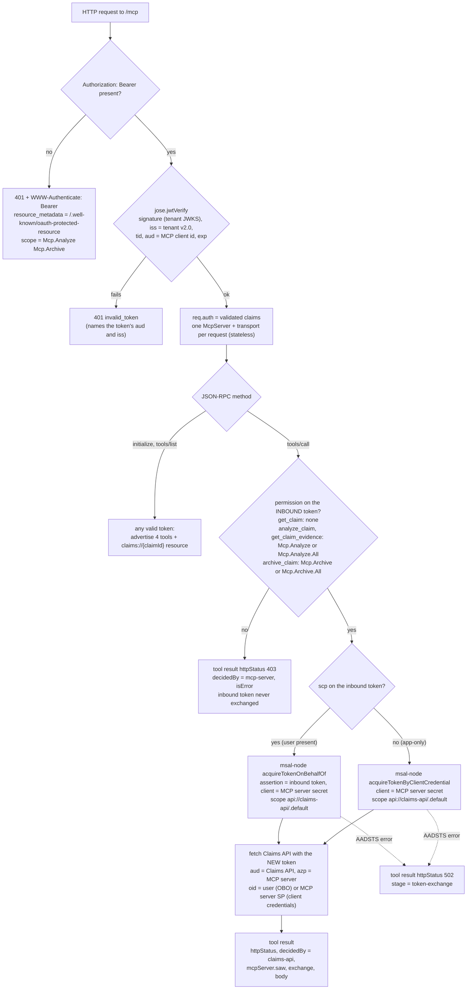

---

## 6. Browser sign-in and token minting

How the UI (and the PowerShell script) obtain the two user tokens used by the delegated
scenarios. This is a POC convenience: a real application never hands bearer tokens to a browser.

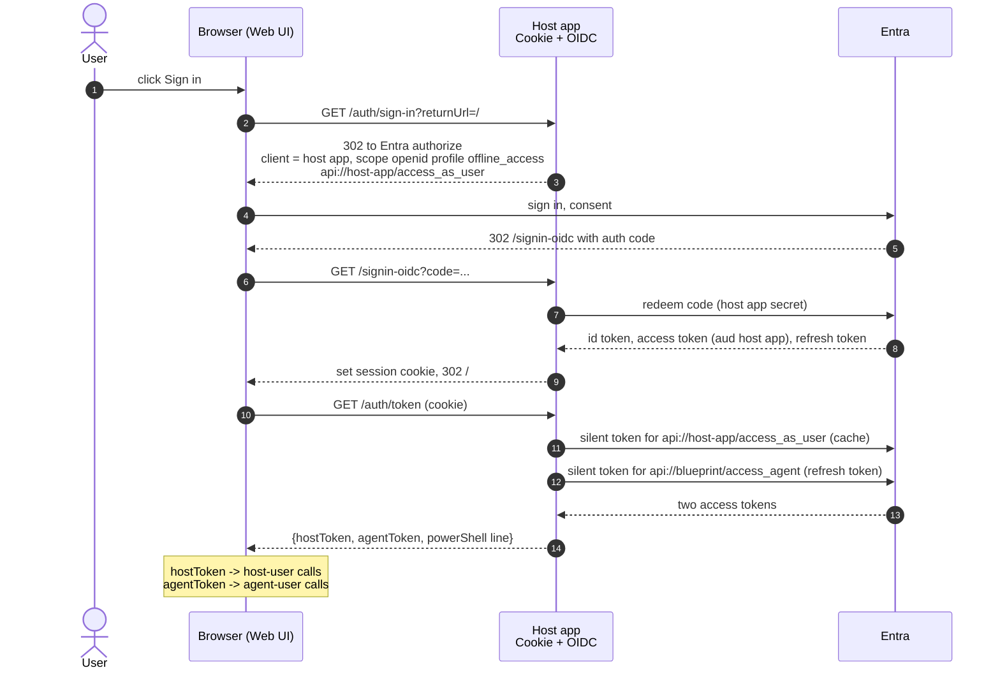

---

## 7. Choosing the identity: decision flow

The rule from Microsoft's guidance: the logical actor performing the operation selects the
identity, not where the code runs.

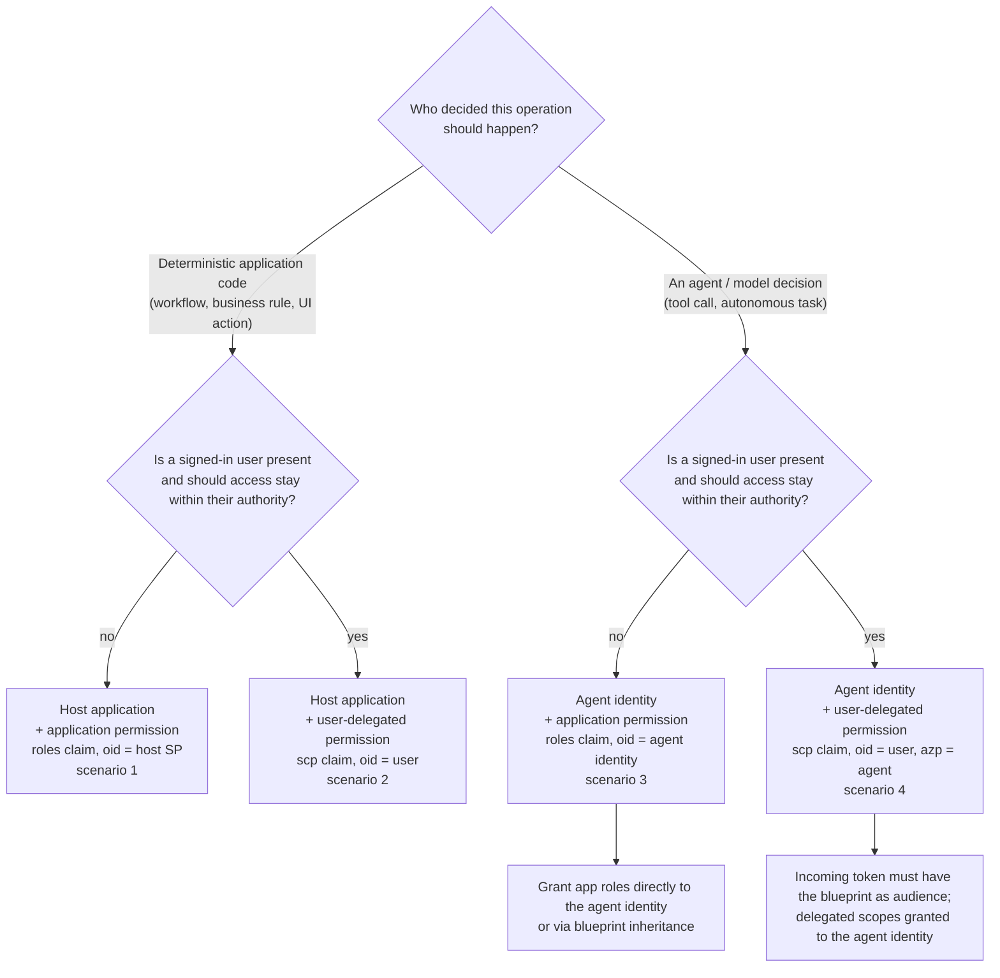

---

## 8. Code structure of the host application

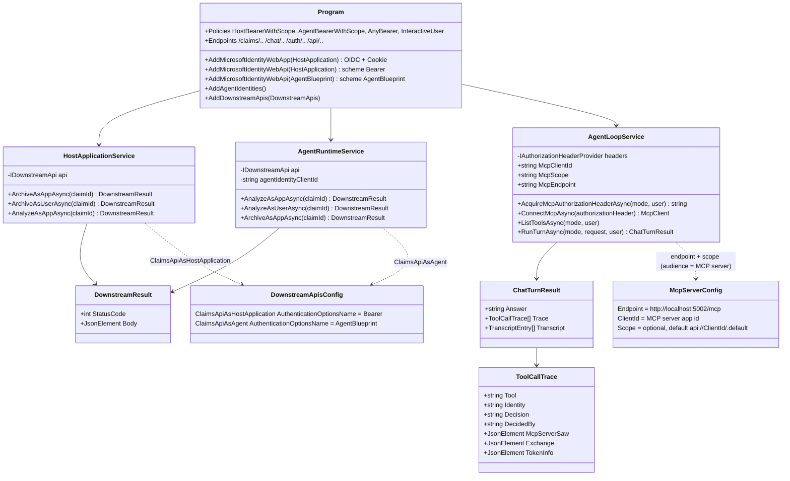

The identity selection lives in exactly two places: the `AuthenticationOptionsName` (which
credential mints the token: the direct services take it from `DownstreamApis` configuration, the
agent loop sets the scheme name itself from the `IdentityMode`) and `WithAgentIdentity(...)` (which
agent identity the token represents). Everything else is ordinary application code. The MCP server
(`claims-mcp/server.mjs`) has no identity choice to make: it validates, authorizes, and exchanges
with the one credential it owns.
