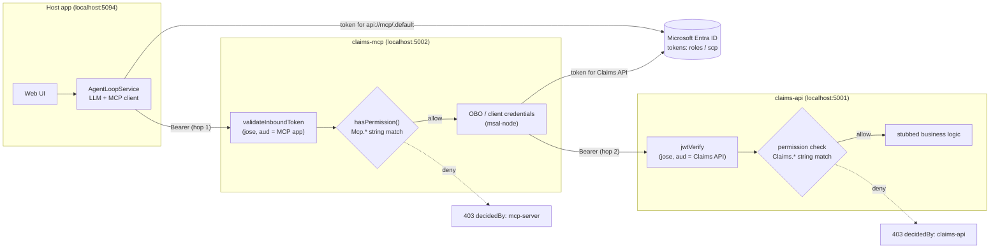
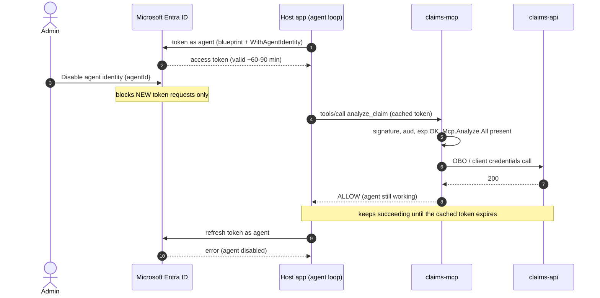
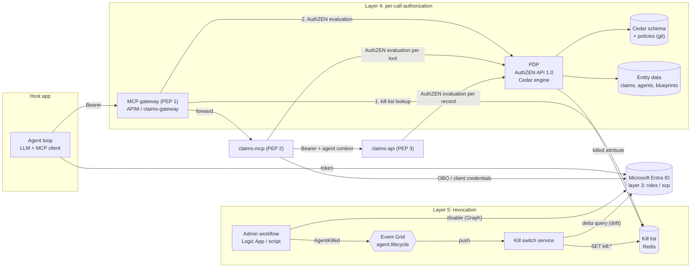
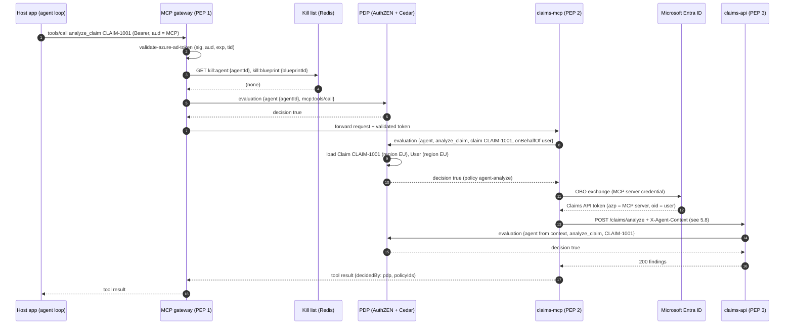
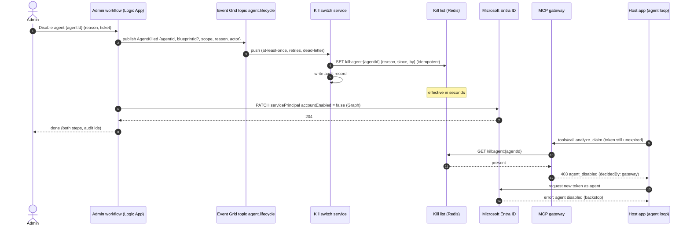
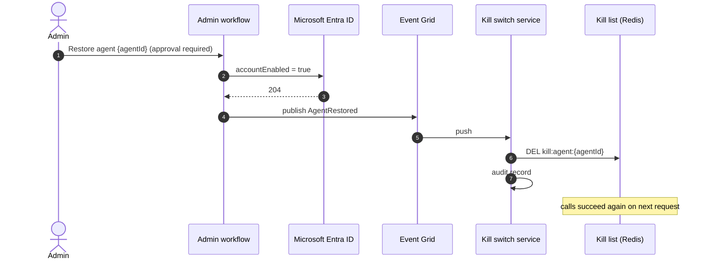
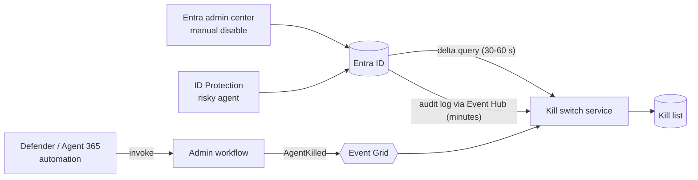
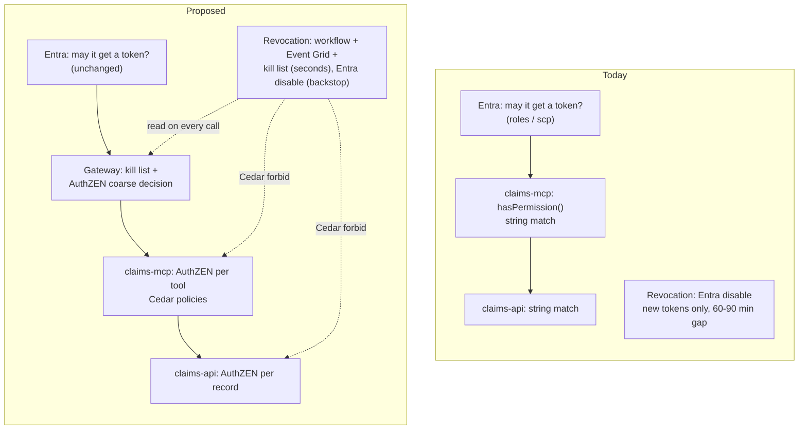

# Proposal: per-call authorization (AuthZEN + Cedar) and an agent kill switch

**Status:** implemented in Azure as the "Local LLM & Gateway MCP" tab ([Local LLM & Gateway MCP](gateway.md);
the differences are listed in [9E](gateway.md#9e-differences-from-proposalmd)). The text below is the original proposal. It describes a
future extension of this POC so the team can compare it with what runs today.

**Builds on:** [Scenarios](scenarios.md), [Entra setup](entra-setup.md) and
[ARCHITECTURE.md](ARCHITECTURE.md) (current diagrams).

---

## 1. Why

The POC shows what Entra can decide: **may this caller get a token for this resource?**
That decision is made once, when the token is minted, and is expressed as coarse
permissions (`roles` / `scp`) that the MCP server and Claims API check with a string
comparison.

Two things are missing for agentic workloads:

| Gap | Today | Consequence |
| --- | --- | --- |
| **Layer 4: per-call authorization** | `hasPermission()` in `claims-mcp/server.mjs` and the Claims API compare `roles`/`scp` against a hard-coded table | No way to say "the agent may analyze claims, but only for the signed-in user's region, at most 50 per hour, and never claims flagged as litigation". Policy is code, duplicated in two services. |
| **Layer 5: near-real-time revocation** | Disable the agent identity in Entra | Entra stops issuing **new** tokens. Tokens already issued stay valid for 60 to 90 minutes, and nothing tells the MCP server or Claims API to stop honouring them. Entra exposes no Shared Signals / CAEP stream for custom resources. |

The proposal adds:

1. An **AuthZEN-compliant Policy Decision Point (PDP)** backed by **Cedar** policies,
   called by every enforcement point (PEP) per request or per tool call.
2. A **kill switch**: an admin workflow that blocks an agent (or a whole blueprint) in
   seconds through Event Grid and a shared kill-list store, then disables it in Entra as
   the backstop.
3. An **MCP gateway** (Azure API Management in a deployed version, a local stand-in in
   the POC) as the first enforcement point in front of the MCP server.

## 2. Layer model

| Layer | Question | Today in the POC | After this proposal |
| --- | --- | --- | --- |
| 1. Registry and lifecycle | Which agents exist, who owns them? | Entra Agent ID objects created by script | unchanged (Agent 365 / ID Governance are out of scope here) |
| 2. Entitlement governance | Which permissions may it hold? | `appRoleAssignments` / `oauth2PermissionGrants` via Graph script | unchanged |
| 3. Token-time authorization | May it get a token at all? | Entra app roles and scopes | unchanged, still required |
| **4. Per-call authorization** | May it do *this action* on *this record* for *this user* now? | `hasPermission()` string match in two services | **AuthZEN PDP + Cedar**, called by gateway, MCP server and Claims API |
| **5. Signals and revocation** | Stop it now | Entra disable (new tokens only) | **Kill switch workflow + Event Grid + kill list**, read on every call; Entra disable as backstop |

Layer 3 stays the coarse gate. Layer 4 refines it and never widens it: a call needs
both an Entra permission **and** a PDP `permit`.

---

## 3. Today (for comparison)

### 3.1 Components and enforcement points today



### 3.2 Revoking an agent today



---

## 4. Proposed architecture

### 4.1 New and changed components

| Component | New / changed | Role | Deployed (Azure) | POC stand-in |
| --- | --- | --- | --- | --- |
| **MCP gateway** | new | PEP 1. Validates token, checks kill list, asks PDP for a coarse decision, forwards to MCP server | Azure API Management (MCP server exposed through APIM), policies `validate-azure-ad-token`, `cache-lookup-value` (external Redis), `send-request` | `claims-gateway/` Node reverse proxy on `localhost:5003` that imitates those policies |
| **Policy Decision Point** | new | Implements the **AuthZEN Authorization API 1.0**, evaluates **Cedar** policies, reads kill list as entity data | Container App running a Cedar engine behind an AuthZEN facade | `claims-pdp/` Node service on `localhost:5010` using `@cedar-policy/cedar-wasm` |
| **Policy store** | new | Cedar schema + policy files, versioned in git | Blob / git, loaded at PDP start and on change | `claims-pdp/policies/*.cedar` |
| **Policy information** (entities) | new | Claim attributes (region, flags), agent ↔ blueprint, kill list | Redis + Claims data source | in-memory JSON + Redis (or in-memory map) |
| **Kill list store** | new | `kill:agent:<id>`, `kill:blueprint:<id>`, `kill:user:<oid>` | Azure Cache for Redis (also the APIM external cache) | local Redis container, or an in-memory map inside `claims-pdp` |
| **Admin workflow** | new | "Disable agent" runbook: publish event, then disable in Entra | Logic App (or Durable Function) with managed identity | `Tests/Disable-Agent.ps1` |
| **Event Grid topic** | new | `agent.lifecycle` events (`AgentKilled`, `AgentRestored`) | Event Grid namespace topic, push to kill switch service, dead-letter to storage | posted straight to the kill switch service's webhook (no local Event Grid emulator) |
| **Kill switch service** | new | Single writer of the kill list; audit; Entra drift sync (delta query) | Azure Function (Event Grid trigger + timer) | `claims-killswitch/` Node service on `localhost:5011` |
| **claims-mcp** | changed | PEP 2. Replace `hasPermission()` with an AuthZEN call per tool; pass agent context downstream | same | same file |
| **claims-api** | changed | PEP 3. Replace the permission check with an AuthZEN call (record level) | same | same file |
| Host app, Entra objects | unchanged | | | |

### 4.2 Component view (proposed)



Each PEP reads the kill list, directly at the gateway (cheap, before anything else) and
through the PDP everywhere else. The gateway is the fast path; the PDP check means a
caller that reaches the MCP server or Claims API without passing the gateway is still
stopped.

---

## 5. Layer 4: OpenID AuthZEN + Cedar

### 5.1 Why both

- **AuthZEN** standardises the **wire contract** between PEP and PDP
  (`POST /access/v1/evaluation`). PEPs written against it do not care which engine
  sits behind it, so the PDP can later be swapped for Amazon Verified Permissions,
  Cerbos, Topaz, Axiomatics or an OPA-based PDP without touching the MCP server or
  Claims API.
- **Cedar** is the **policy language and engine**. It is open source (CNCF), analysable
  (policies can be checked for conflicts and over-permission before deployment),
  default-deny, and `forbid` always beats `permit`, which is exactly what a kill switch
  needs.

There is no Azure-native Cedar service. In Azure the PDP is a small container (Cedar via
the Rust crate or `cedar-wasm`) with an AuthZEN facade. On AWS the same policies could be
hosted by Amazon Verified Permissions or AgentCore Policy.

### 5.2 Mapping token claims to AuthZEN subjects

The PEPs build the AuthZEN request from claims the POC already reads (`summarizeInbound`
in `claims-mcp/server.mjs`):

| AuthZEN field | Source | Scenario 1 host app | Scenario 3 agent | Scenario 4 agent for user |
| --- | --- | --- | --- | --- |
| `subject.type` | `xms_par_app_azp` present ⇒ `agent`, else `application` (or `user` when delegated, see below) | `application` | `agent` | `agent` |
| `subject.id` | `azp` / `appid` | `<host-app-id>` | `<agent-identity-id>` | `<agent-identity-id>` |
| `subject.properties.blueprint` | `xms_par_app_azp` | — | `<blueprint-id>` | `<blueprint-id>` |
| `subject.properties.permissions` | `roles` or `scp` | `["Claims.Archive.All"]` | `["Claims.Analyze.All"]` | `["Claims.Analyze"]` |
| `context.onBehalfOf` | `oid` when `scp` present | — | — | user `<user-object-id>` |
| `action.name` | MCP tool / HTTP route | `archive_claim` | `analyze_claim` | `analyze_claim` |
| `resource` | tool argument / route | `{type: "claim", id}` | `{type: "claim", id}` | `{type: "claim", id}` |

The **actor** is always the `subject` (the identity that holds the credential: host app
or agent). The user, when present, travels in `context.onBehalfOf` so policies can say
"agent X acting for user Y".

### 5.3 AuthZEN request and response (MCP server, `analyze_claim`, scenario 4)

```http
POST /access/v1/evaluation HTTP/1.1
Host: claims-pdp
Content-Type: application/json
Authorization: Bearer <MCP server's own token for the PDP>
X-Request-ID: 7f3c…

{
  "subject": {
    "type": "agent",
    "id": "<agent-identity-id>",
    "properties": {
      "blueprint": "<blueprint-id>",
      "permissions": ["Mcp.Analyze"],
      "tenant": "<tenant-id>"
    }
  },
  "action": { "name": "analyze_claim" },
  "resource": { "type": "claim", "id": "CLAIM-1001" },
  "context": {
    "onBehalfOf": "<user-object-id>",
    "pep": "claims-mcp",
    "time": "2026-10-29T10:15:00Z"
  }
}
```

```json
{
  "decision": false,
  "context": {
    "reason_admin": { "en": "forbid: agent is on the kill list (blueprint <blueprint-id>)" },
    "reason_user":  { "en": "This agent has been disabled by an administrator." },
    "policyIds": ["kill-switch-blueprint"],
    "policyVersion": "2026-10-29.3"
  }
}
```

Other AuthZEN endpoints worth using:

| Endpoint | Use in this POC |
| --- | --- |
| `GET /.well-known/authzen-configuration` | PEPs discover the PDP's endpoints |
| `POST /access/v1/evaluations` (batch) | The host app's UI or the MCP server's `tools/list` asks "which of these 4 tools may this caller use?" in one call, so the LLM is only offered allowed tools |
| `POST /access/v1/search/resource` | "Which claims may this agent analyze?" for list views (optional, later) |

### 5.4 Cedar schema

```cedar
namespace Claims {
  entity Blueprint = { killed: Bool };
  entity Agent in [Blueprint] = { killed: Bool };
  entity Application = { killed: Bool };
  entity User = { region: String, killed: Bool };

  entity Claim = {
    region: String,
    status: String,          // "open" | "archived"
    litigationHold: Bool,
  };

  type RequestContext = {
    permissions: Set<String>,       // roles or scp from the Entra token
    onBehalfOf?: User,
    pep: String,
  };

  action "get_claim", "get_claim_evidence", "analyze_claim", "archive_claim"
    appliesTo {
      principal: [Agent, Application],
      resource: Claim,
      context: RequestContext,
    };
}
```

`Agent in [Blueprint]` mirrors Entra's blueprint → agent identity relationship, so one
policy on a blueprint covers every agent created from it.

### 5.5 Cedar policies

```cedar
// ---------- Layer 5: kill switch (evaluated like any other policy) ----------

@id("kill-switch-agent")
forbid (principal, action, resource)
when { principal.killed };

@id("kill-switch-blueprint")
forbid (principal is Claims::Agent, action, resource)
when { principal in Claims::Blueprint::"<blueprint-id>"
       && Claims::Blueprint::"<blueprint-id>".killed };
// In practice generated per blueprint, or the PDP sets principal.killed = true
// when the agent's parent blueprint is on the kill list.

@id("kill-switch-user")
forbid (principal, action, resource)
when { context has onBehalfOf && context.onBehalfOf.killed };

// ---------- Layer 4: mirror today's Entra permissions (coarse) ----------

@id("agent-analyze")
permit (
  principal is Claims::Agent,
  action in [Claims::Action::"analyze_claim", Claims::Action::"get_claim_evidence",
             Claims::Action::"get_claim"],
  resource
)
when { context.permissions.containsAny(["Mcp.Analyze", "Mcp.Analyze.All",
                                        "Claims.Analyze", "Claims.Analyze.All"]) };

@id("host-archive")
permit (
  principal is Claims::Application,
  action == Claims::Action::"archive_claim",
  resource
)
when { context.permissions.containsAny(["Mcp.Archive", "Mcp.Archive.All",
                                        "Claims.Archive", "Claims.Archive.All"]) };

// ---------- Layer 4: what Entra cannot express ----------

@id("agent-same-region-as-user")
forbid (principal is Claims::Agent, action, resource)
when { context has onBehalfOf && resource.region != context.onBehalfOf.region };

@id("no-agent-on-litigation-hold")
forbid (principal is Claims::Agent, action, resource)
when { resource.litigationHold };

@id("no-archive-twice")
forbid (principal, action == Claims::Action::"archive_claim", resource)
when { resource.status == "archived" };
```

Notes:

- Cedar is **default deny**: anything not permitted is refused, and every `forbid`
  overrides every `permit`. The kill switch therefore cannot be bypassed by a broader
  permit added later.
- The `agent-analyze` and `host-archive` permits restate the Entra grants. They are
  deliberate duplicates: Entra stays authoritative for *getting* a token, Cedar becomes
  authoritative for *using* it, and neither alone is enough.
- Rate limits ("50 per hour") are better enforced at the gateway (`rate-limit-by-key`
  in APIM keyed on `azp`) than in Cedar, which evaluates one request at a time.

### 5.6 Where each PEP sits and what it asks

| PEP | Today | Proposed | Granularity |
| --- | --- | --- | --- |
| **MCP gateway** (new) | — | Validate Entra token; kill-list lookup; AuthZEN evaluation with `action = "mcp:<method>"` (for example `mcp:tools/call`) | coarse: may this caller talk to the MCP server at all |
| **claims-mcp** | `hasPermission(payload, PERMISSIONS.analyze)` | AuthZEN evaluation with `action = <tool name>`, `resource = claim id`; for `tools/list`, a batch evaluation to filter the tool list | per tool, per claim |
| **claims-api** | role / scope string match | AuthZEN evaluation with the record loaded (region, status, hold) as resource properties | per record |

### 5.7 Per-call flow (proposed, scenario 4)



### 5.8 Carrying the agent across hop 2

After the exchange, the Claims API token names the **MCP server** as `azp` ([section
8B](mcp-server.md#8b-what-changes-in-the-tokens)). The agent identity is gone from the token, so the Claims API cannot ask
the PDP about the agent on its own.

| Option | How | Trade-off |
| --- | --- | --- |
| **A. Trust the MCP server's decision** (recommended for the POC) | Claims API asks the PDP only about `subject = MCP server` and the user; the per-agent decision is made at PEP 2 | Simple. The Claims API trusts the MCP server for agent attribution, which it already does in today's OBO design |
| **B. Signed agent context header** | MCP server adds `X-Agent-Context`, a short-lived JWS signed with the MCP server's key containing `agent`, `blueprint`, `requestId`; Claims API verifies and passes it to the PDP | Agent-aware record checks at the API; a home-grown format |
| **C. OAuth Transaction Tokens** (future) | A Transaction Token Service issues a signed token carrying the original agent and user through every hop (`draft-ietf-oauth-transaction-tokens`) | The standard answer, but no Entra or Azure support today; would need a self-hosted TTS |

Option A keeps the POC honest about what Entra provides; option C is listed so the
team can see where the standards are heading.

---

## 6. Layer 5: the kill switch

### 6.1 Design rules

1. **Fast path first, backstop second.** The workflow publishes the kill event before it
   disables the identity in Entra. If it fails half-way, the fast block has already
   happened.
2. **One writer.** Only the kill switch service writes the kill list. The workflow,
   the Entra drift sync and any future source (Defender, Agent 365 automation) all go
   through it, so there is one audit trail.
3. **Shared store, not push.** Gateways and the PDP read the kill list from Redis on
   every call (with a cache TTL of a few seconds at most). No per-gateway subscription,
   no fan-out, and new gateway instances are correct from their first request.
4. **Granularity follows Entra's model.** Kill one agent (`azp`), every agent of a
   blueprint (`xms_par_app_azp`), or every agent acting for one user (`oid`).
5. **Fail closed for agents.** If the kill list cannot be read, agent callers are
   denied; host-app and user callers follow a configurable choice.

### 6.2 Kill flow



### 6.3 Event schema (CloudEvents 1.0 on Event Grid)

```json
{
  "specversion": "1.0",
  "type": "Poc.Agent.Killed",
  "source": "/poc/claims/admin-workflow",
  "subject": "agents/<agent-identity-id>",
  "id": "c1f0…",
  "time": "2026-10-29T10:14:52Z",
  "datacontenttype": "application/json",
  "data": {
    "scope": "agent",                      // "agent" | "blueprint" | "user"
    "agentId": "<agent-identity-id>",
    "blueprintId": "<blueprint-id>",
    "reason": "Suspected prompt injection, INC-4821",
    "requestedBy": "admin@contoso.onmicrosoft.com",
    "expiresAt": null                      // optional time-boxed kill
  }
}
```

`Poc.Agent.Restored` has the same shape. The CloudEvents `id` is the idempotency key.

### 6.4 Restore flow (order reversed)



Restoring Entra first and clearing the kill list last means there is never a window in
which the identity is blocked in Entra but allowed at the PEPs, or the reverse with a
token still live.

### 6.5 Drift: disables that bypass the workflow

Someone may disable the agent directly in the Entra admin center, or Entra ID
Protection may block a risky agent. Microsoft Graph does not publish service principal
or agent identity changes to Event Grid, so the kill switch service also runs:

| Mechanism | Latency | Notes |
| --- | --- | --- |
| Timer: `GET /servicePrincipals/delta` filtered to agent identities and blueprints | 30 to 60 s (poll interval) | Watches `accountEnabled`; writes `kill:*` with `reason = "disabled in Entra"` |
| Entra audit logs → diagnostic settings → Event Hub | typically minutes | Catches the actor and reason; good for audit, too slow as the only path |
| Defender / Agent 365 automation calling the workflow | seconds | Preferred route for automated responses |



### 6.6 Failure modes

| Failure | Effect | Mitigation |
| --- | --- | --- |
| Event Grid delivery fails | Kill list not updated | Retries + dead-letter to storage; workflow polls kill switch status before reporting success; drift sync catches it within a minute once Entra is disabled |
| Redis unavailable | PEPs cannot read kill list | Fail closed for `subject.type = agent`; alert |
| PDP unavailable | No decisions | Fail closed at every PEP; gateway returns 503 with `decidedBy: gateway` |
| Duplicate events | Repeated SET / DEL | Idempotent writes keyed on CloudEvents `id` |
| Caller skips the gateway | No gateway check | PEP 2 and PEP 3 also consult the PDP, which reads the kill list; production network rules allow the MCP server only from APIM |
| Kill list entry outlives the incident | Agent blocked indefinitely | Optional `expiresAt`; restore workflow; access review lists active kills |

---

## 7. Today vs proposed, side by side

### 7.1 Decision points



### 7.2 Behaviour by scenario

| Scenario | Today | Proposed |
| --- | --- | --- |
| 1. Host app, no user, archive | ALLOW (`Claims.Archive.All`) | ALLOW via `host-archive`, unless claim already archived (`no-archive-twice`) |
| 2. Host app for user, archive | ALLOW (`Claims.Archive`) | same as 1, plus user kill (`kill-switch-user`) |
| 3. Agent, no user, analyze | ALLOW (`Claims.Analyze.All`) | ALLOW via `agent-analyze`, DENY on litigation hold or if the agent/blueprint is killed |
| 4. Agent for user, analyze | ALLOW (`Claims.Analyze`) | as 3, plus DENY if claim region ≠ user region |
| N1. Agent archives | 403 at Claims API / MCP server (no permission) | 403 at PDP (no permit), same outcome, one place |
| Agent disabled mid-session | keeps working until the token expires | 403 at the gateway within seconds |
| `tools/list` | lists all four tools | lists only the tools the PDP allows (batch evaluation), so the LLM is never offered a forbidden tool |

### 7.3 Trace changes in the UI

The existing trace (`decidedBy`, `mcpServerSaw`, `exchange`) gains:

```json
{
  "decidedBy": "pdp",
  "pep": "claims-mcp",
  "authzen": {
    "request": { "subject": { "type": "agent", "id": "<agent-identity-id>" }, "action": { "name": "analyze_claim" }, "resource": { "type": "claim", "id": "CLAIM-1001" } },
    "decision": false,
    "policyIds": ["agent-same-region-as-user"],
    "policyVersion": "2026-10-29.3"
  },
  "killList": { "checked": true, "hit": false }
}
```

`decidedBy` gains two values: `gateway` (kill list or coarse AuthZEN deny) and `pdp`.

---

## 8. Changes by file (when implemented)

| Path | Change |
| --- | --- |
| `claims-gateway/` (new) | Node reverse proxy imitating APIM: Entra token validation (jose), kill list lookup, AuthZEN call, forward to `claims-mcp`. Host app's `McpServer:Endpoint` points here (`localhost:5003`). |
| `claims-pdp/` (new) | AuthZEN Authorization API 1.0 (`/.well-known/authzen-configuration`, `/access/v1/evaluation`, `/access/v1/evaluations`); Cedar via `@cedar-policy/cedar-wasm`; loads `policies/*.cedar` and `schema.cedarschema`; reads kill list and claim attributes as entities. |
| `claims-killswitch/` (new) | Event Grid webhook (CloudEvents, subscription validation handshake), Redis writer, audit log, `servicePrincipals/delta` timer, `GET /kills` for the UI. |
| `claims-mcp/server.mjs` | Replace `hasPermission()` with `authorize(payload, toolName, claimId)` → AuthZEN; filter `tools/list` with a batch evaluation; add `authzen` and `killList` to the trace; optional `X-Agent-Context` (section 5.8 option B). |
| `claims-api/server.js` | Replace the role/scope check with an AuthZEN call using the loaded claim record; keep JWT validation unchanged. |
| `AgentLoopService.cs`, `wwwroot/app.js` | Show the new trace fields; add a "Kill agent" / "Restore agent" button that calls the workflow stand-in. |
| `Tests/Disable-Agent.ps1`, `Tests/Restore-Agent.ps1` (new) | Workflow stand-ins: publish the CloudEvent, then Graph `accountEnabled` change (order per section 6). |
| `Tests/Invoke-ClaimsIdentityTests.ps1` | New cases: region mismatch, litigation hold, kill mid-session (expect 403 from the gateway with an unexpired token), restore. |
| `appsettings.json`, `claims-mcp/config.json` | PDP URL, gateway URL, Redis connection, fail-closed switch. |
| `ARCHITECTURE.md`, `README.md` | Add the diagrams from sections 4, 5 and 6 and a "Layers 4 and 5" section. |

Entra changes: none required for the POC. A deployed version adds an app registration
for the PDP (so PEPs authenticate to it with their own tokens) and a managed identity for
the workflow with `Application.ReadWrite.All` (or the narrower agent-identity
permission when available) to disable agents.

## 9. Localhost vs Azure

| Concern | POC (local) | Azure deployment |
| --- | --- | --- |
| Gateway | `claims-gateway` Node proxy | API Management with MCP server support; policies `validate-azure-ad-token`, `cache-lookup-value` against external Azure Cache for Redis, `send-request` to the PDP, `rate-limit-by-key` on `azp` |
| Event Grid | Script posts the CloudEvent straight to the kill switch webhook (Event Grid has no local emulator) | Event Grid namespace topic, push subscription to an Azure Function, dead-letter container |
| Kill list | Redis in Docker, or in-memory inside `claims-pdp` | Azure Cache for Redis, private endpoint |
| PDP | Node + `cedar-wasm` | Container Apps, two replicas minimum, policies from a storage container with versioning |
| Workflow | PowerShell scripts | Logic App with managed identity and an approval step for restore |
| Latency target | under 1 s from script to 403 | under 5 s from workflow start to 403 at every gateway |

## 10. Standards status (November 2026)

The README's [Emerging standards and layers](../README.md#emerging-standards-and-layers) section
also maps these standards and the matching products to each layer.

| Standard | Status | Used here |
| --- | --- | --- |
| [OpenID AuthZEN Authorization API 1.0](https://openid.net/wg/authzen/specifications/) | Final (January 2026). The MCP tool authorization profile (COAZ) and the Access Request and Approval Profile (AARP) became working-group drafts in June 2026 | Yes, PEP ↔ PDP contract |
| [Cedar](https://www.cncf.io/projects/cedar/) | Open source; CNCF Sandbox since October 2025. Used by Amazon Verified Permissions and AgentCore Policy (GA March 2026) | Yes, policy language and engine |
| [CloudEvents 1.0](https://cloudevents.io/) | CNCF graduated; native on Event Grid | Yes, kill / restore events |
| [OpenID Shared Signals Framework / CAEP / RISC 1.0](https://openid.net/specs/openid-sharedsignals-framework-1_0-final.html) | Final (published September 2025). Entra's CAE uses CAEP for Microsoft resources but sends no events to custom APIs | No. The Event Grid design fills the same role; the kill switch service could later act as an SSF transmitter |
| [OAuth Transaction Tokens](https://datatracker.ietf.org/doc/draft-ietf-oauth-transaction-tokens/) | IETF OAuth working-group draft (-11, July 2026), past working-group consensus and waiting for write-up; no Entra support | Listed as section 5.8 option C only |
| [ID-JAG](https://datatracker.ietf.org/doc/draft-ietf-oauth-identity-assertion-authz-grant/) (Identity Assertion JWT Authorization Grant) | IETF OAuth working-group draft (-06, October 2026). Used by the MCP Enterprise-Managed Authorization extension; Okta ships it as Cross App Access. No Entra support announced | No |
| [MCP authorization](https://modelcontextprotocol.io/specification/2026-07-28/basic/authorization) | Part of MCP revision 2026-07-28: Protected Resource Metadata required, Client ID Metadata Documents preferred over dynamic registration | Partly: the MCP server is its own OAuth resource with audience binding ([details](mcp-server.md)) |
| [IETF WIMSE AI agent work](https://datatracker.ietf.org/doc/draft-ietf-wimse-aims/) | `draft-ietf-wimse-aims` (-01, November 2026) is a WIMSE working-group document that replaces the individual `draft-klrc-aiagent-auth`; further individual drafts on agent identity and delegation | No |
| [SCIM for agents](https://datatracker.ietf.org/doc/draft-wzdk-scim-agent-resource/) | Individual draft (-00, June 2026, authors from Microsoft and Okta) adding an `Agent` resource type to SCIM; a governance extension draft builds on it | No |
| [A2A protocol](https://a2a-protocol.org/latest/) | Version 1.0 (2026) under the Linux Foundation; adds signed Agent Cards | No |

## 11. Open questions

1. Should the PDP also be the place that enforces rate limits, or keep those in the
   gateway only?
2. Option A or B for carrying the agent across hop 2 (section 5.8)?
3. Who may restore a killed agent: the sponsor, a security admin, or both with approval?
4. Should killing a blueprint also disable the blueprint in Entra (stopping every agent
   it mints), or only the kill list?
5. Is a self-hosted Cedar PDP acceptable for production, or should the team evaluate a
   commercial AuthZEN PDP?
